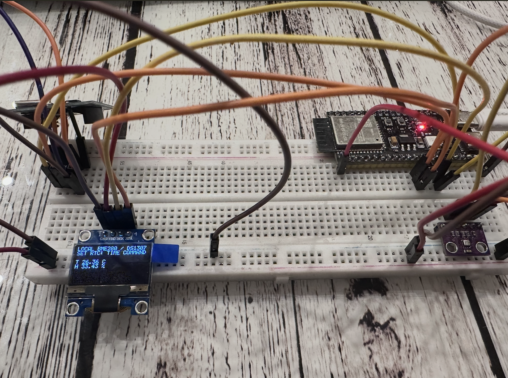

# RTOS MQTT Data Logger

An **ESP32-S3 / ESP-IDF / FreeRTOS** project built with PlatformIO: 1 Hz environmental
telemetry, MQTT, OLED display and timestamped flash logging. EMB1 6.8.



## Design

Five application tasks communicate through queues; a mutex protects I²C.
Automatic Light Sleep and Wi-Fi modem sleep reduce idle power consumption.

| Task | Responsibility |
| --- | --- |
| Sensor | BME280 forced-mode measurements and DS1307 timestamps |
| Manager | Sampling schedule, logging interval and system state |
| Display | Local / remote OLED pages, refreshed at 1 Hz |
| UART | Commands and console wake-up |
| Flash Writer | Buffered writes, capacity checks and erase operations |

## Hardware

ESP32-S3-DevKitC-1 with 16 MB flash. Shared **SDA GPIO8, SCL GPIO9 and GND**:

| Module | Supply | I²C address |
| --- | --- | --- |
| BME280 | 3.3 V | `0x76` |
| SSD1306, 128×64 | 3.3 V | `0x3C` |
| DS1307 with backup battery | 5 V | `0x68` |

Keep I²C pull-ups at 3.3 V; modify the RTC module's 5 V pull-ups or use a level shifter.
Use the **USB-to-UART connector** for commands; native USB can disconnect during sleep.

## Run

```sh
cp include/config.local.example.h include/config.local.h
pio run -t upload
pio device list
pio device monitor --port YOUR_UART_PORT
```

Set credentials and MQTT prefixes in `config.local.h`; replace `YOUR_UART_PORT` with
its device-list path. Pins and logging interval are in [`include/config.h`](include/config.h).
Set DS1307 once using `time` (UTC). An empty SSID runs offline.

Default broker: `broker.hivemq.com:1883`, MQTT 3.1.1 / QoS 0, using ESP-IDF's lwIP client.
Publishes `EMB1/ymironov/bme280/{temp,hum,pres}` in **°C, %, mmHg**;
subscribes to `EMB1/teacher/bme280/+`. OLED pages alternate every five seconds.
Connections retry automatically; remote readings expire after ten seconds.

## Console

115200 baud. After 30 seconds idle, press Enter to wake, then send a command.

| Command | Action |
| --- | --- |
| `status` | Readings, network, flash usage and sleep statistics |
| `log on` / `log off` | Enable or pause logging, retaining buffered records |
| `flush` | Write buffered records to a padded sector |
| `erase` | Clear flash and RAM logs; leave logging off |
| `time YYYY-MM-DDTHH:MM:SS` | Set DS1307 in UTC |

## Storage

A 1 MiB `logdata` partition and one 4096-byte RAM buffer hold **256 records per sector**.
Records are 16-byte little-endian: Unix seconds (`uint64`), °C × 100 (`int32`),
% × 100 (`uint16`), mmHg (`uint16`). Logging starts with the first valid sample,
then repeats every minute by default.

Full buffers write automatically; `flush` pads with `0xFF`. Boot scans occupied sectors
to resume without overwriting logs. No metadata or wear leveling. Full flash stops logging
and reports it on UART and OLED. Unflushed RAM records are lost on reset.

## Tests

Run `python3 tests/run_tests.py` for flash recovery and capacity, I/O failure handling,
DS1307 calendar validation and BME280 compensation. Tests use address and undefined-behavior sanitizers.
